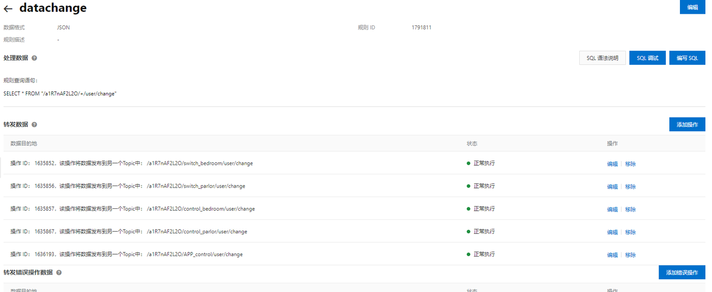
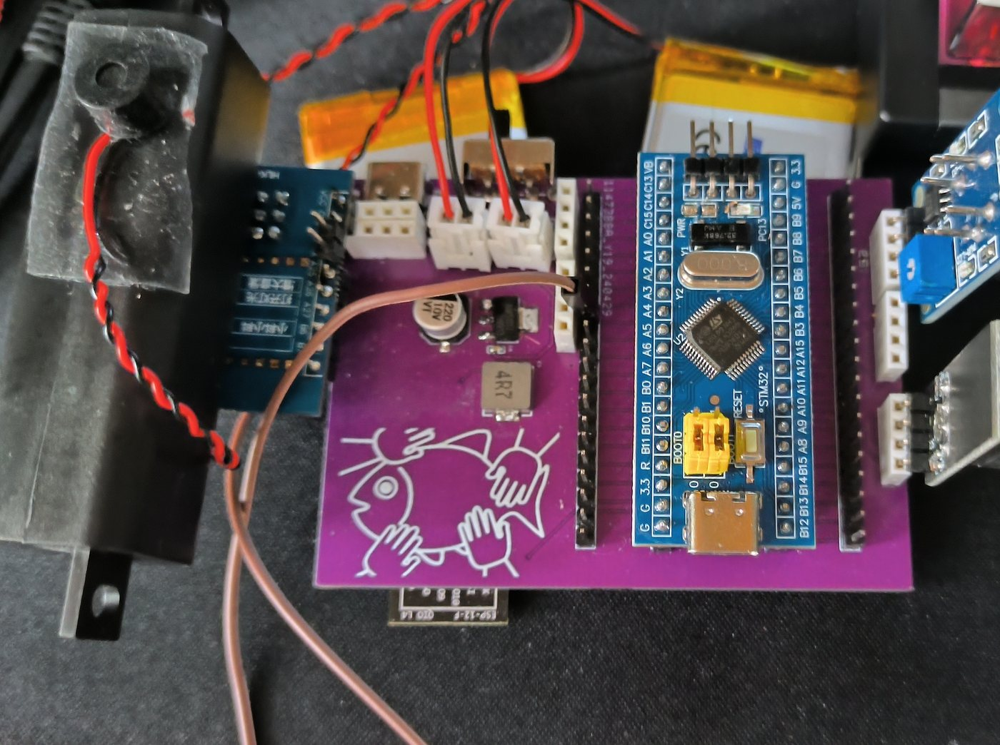
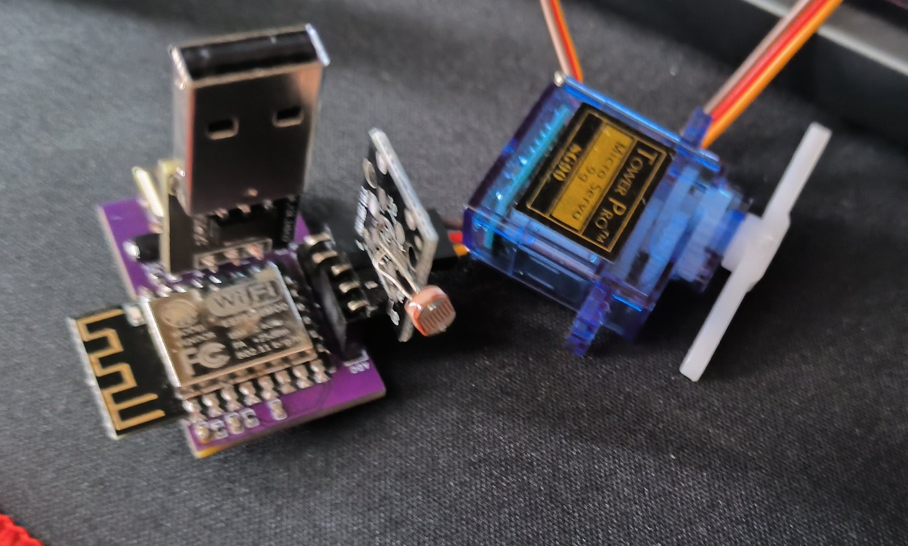
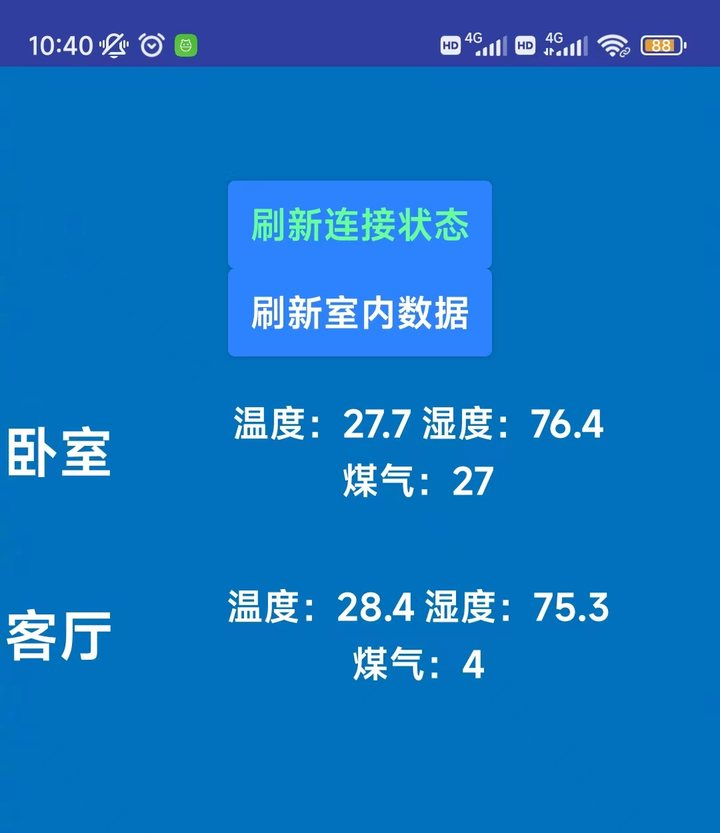
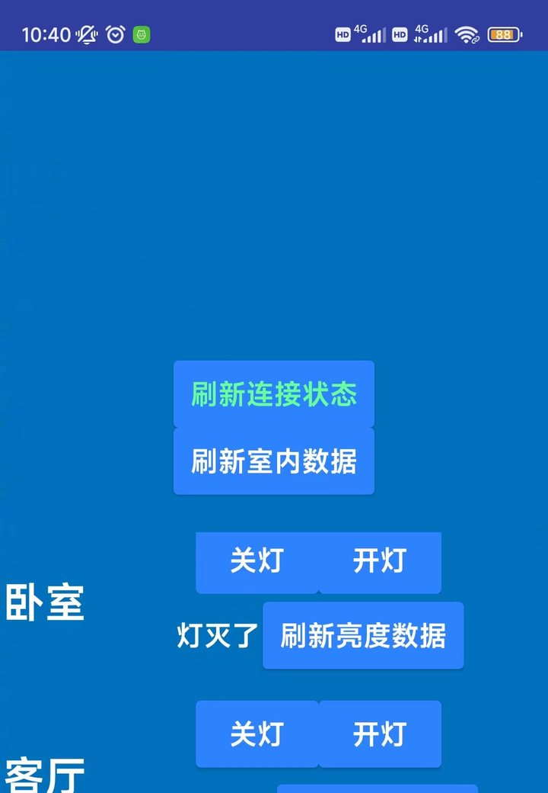

# 基于 STM32 与阿里云的智能家居系统

> 不改线路、不换开关面板的低成本智能家居改造方案
> STM32 + ESP8266 + 阿里云 IoT + Android


## 项目简介

多数智能家居方案要求装修阶段预埋线路，或者更换整套开关面板，对租房和已装修家庭并不友好。本项目尝试用尽量低的改造成本解决这个问题：

- **不动原有线路**：分控端用舵机拨动墙上原有的翘板开关，不接触市电；
- **不换面板**：分控端直接插在墙面插座上取电，即插即用；
- **三种控制方式**：本地语音、手机 APP 远程、传感器自动控制；
- **按需扩展**：主控端一个，分控端按房间数量增减。

系统由主控端、分控端、阿里云 IoT 平台和 Android APP 组成。主控端负责语音识别与环境采集，分控端负责开关灯执行，两端通过 MQTT 与阿里云通信。整套系统在卧室实际安装并连续运行 4 个月完成测试记录，之后继续日常使用，累计约一年半，未出现故障。

## 项目概况

- **独立完成**：需求、选型、电路、PCB、结构、固件、云端规则、APP 全部由我完成；
- **实测**：设备在真实卧室连续记录 4 个月，之后继续日常使用，累计约一年半；记录见 [05 测试与分析](docs/05-testing.md)；
- **仓库内容**：固件源码在 [firmware/](firmware/)，PCB 工程在 [hardware/](hardware/)，实物照片在 [images/](images/)；
- **复盘**：[06 复盘](docs/06-retrospective.md) 写了设计取舍、遗留缺陷和如果重做的方案。

## 功能

| 功能 | 实现方式 |
| --- | --- |
| 语音开关灯 | HLK-V20 本地语音识别 → STM32 → MQTT 广播 → 分控舵机 |
| APP 远程控制 | Android APP 通过 MQTT 连接阿里云，下发控制命令 |
| 温湿度监测 | AHT20（I2C）采集，主控端上报 |
| 可燃气体监测 | MQ-4（ADC）采集，超阈值时 APP 字体标红告警 |
| 亮度监测 | 分控端光敏电阻（ADC），用于自动关灯与状态判断 |
| 空调控制 | 主控端红外发射模块，语音或 APP 触发 |
| 自动关灯 | 到达设定时间后判断亮度，低于阈值则关灯，阈值可在 APP 设置 |

## 硬件组成

| 模块 | 器件 | 作用 |
| --- | --- | --- |
| 主控 | STM32C8T6 核心板 | 语音结果解析、环境采集、红外控制、串口转发 |
| 联网 | ESP8266 | AT 指令接入阿里云，MQTT 收发 |
| 温湿度 | AHT20 | I2C 数字温湿度 |
| 可燃气体 | MQ-4 | 模拟输出，检测甲烷等可燃气体 |
| 语音识别 | HLK-V20 | 本地关键词识别，串口输出结果 |
| 分控主控 | ESP8266 | 兼作主控与联网，PWM 驱动舵机 |
| 执行器 | SG90 舵机 | 拨动墙面开关 |
| 亮度检测 | 光敏电阻模块 | 模拟输出，判断环境亮度 |
| 电源 | AMS1117-5V / AMS1117-3.3 | 双锂电池与 USB 双路供电、稳压 |
| 烧录 | CH340C + 按键 | USB 转串口，按键拉低 RST/GPIO0 进入烧录 |

## 关键设计

### 1. 免改造的开关控制

分控端不切断原有电路，而是用 SG90 舵机带动拨片按压翘板开关。安装时只需把分控端插到开关旁边的插座上，用玻璃胶或支架固定舵机。早期版本直接用胶粘舵机，长期使用后出现粘连导致按压失败；后期加装了专用拨片结构，减小所需按压力度，测试期间未再复发。


### 2. 双路供电与充电

主控端支持两种供电方式：不接 USB 时由两节 3.7V 锂电池串联供电，经 AMS1117-5V 降压后输入核心板；接入 USB 时优先使用外部 5V，同时通过电源管理芯片给电池充电。分控端则把卧式 USB 公头改为立式，直接插在 5V 充电头上取电。


### 3. 云端消息广播

阿里云 IoT 的规则引擎把任意设备上报的消息转发到各分控与 APP 对应的 topic，设备之间不需要知道彼此地址，新增分控端时只需在云端加一条转发规则。



## 实物

| 主控端 | 分控端 |
| --- | --- |
|  |  |

| APP 数据查看 | APP 灯具控制 |
| --- | --- |
|  |  |

## 仓库结构

```
smart-home-stm32/
├── README.md
├── docs/
│   ├── 01-system-design.md      # 需求、方案对比、系统架构
│   ├── 02-hardware.md           # 主控/分控、电源、电路、PCB、结构
│   ├── 03-firmware.md           # 固件流程、通信协议、物模型
│   ├── 04-cloud-and-app.md      # 阿里云配置、规则引擎、Android APP
│   ├── 05-testing.md            # 测试方法、结果、问题与修复
│   └── 06-retrospective.md      # 复盘：不足与改进方向
├── firmware/
│   ├── README.md                # 编译说明与配置占位符
│   ├── stm32/                   # 主控端（STM32F103 + 标准外设库 + Keil）
│   │   ├── control_bedroom/     # 卧室主控
│   │   └── control_parlor/      # 客厅主控
│   └── esp8266/                 # 分控端（ESP8266 NONOS SDK）
│       ├── switch_bedroom/      # 卧室分控
│       └── switch_parlor/       # 客厅分控
├── hardware/
│   ├── README.md
│   └── pcb/                     # Altium Designer 分控板工程
└── images/
```

## 文档导航

| 文档 | 内容 |
| --- | --- |
| [01 系统设计](docs/01-system-design.md) | 目标用户、需求分析、技术选型与架构 |
| [02 硬件设计](docs/02-hardware.md) | 器件选型、电源与烧录电路、PCB 与结构 |
| [03 固件设计](docs/03-firmware.md) | 主控/分控程序逻辑、MQTT 与物模型 |
| [04 云平台与 APP](docs/04-cloud-and-app.md) | 阿里云配置、规则引擎、Android 开发 |
| [05 测试与分析](docs/05-testing.md) | 长期实测记录（记录期 4 个月，累计使用约一年半）与问题处理 |
| [06 复盘](docs/06-retrospective.md) | 设计取舍、遗留问题、如果重做 |

## 测试结果

- 在卧室实际安装，连续记录 **4 个月**，之后继续日常使用，累计约 **一年半**，语音与手动开关均正常，未出现故障；
- 4 米范围内用接近标准的普通话可稳定识别；
- 分控端体积约 3 × 4 × 2 cm，可直接插在墙面插座上；
- 自动关灯在设定时间判断亮度，低于阈值时触发，阈值可由 APP 调整；
- 主要遗留问题：只能控制单个翘板开关，无法控制连排开关；主控端使用核心板，体积偏大。

## 说明

- 本项目为本科毕业设计（广东海洋大学 · 物联网工程），用于学习与技术交流，不是商业产品。
- 本仓库收录设计文档、电路图与实物记录，以及**主控端与分控端固件源码、分控板 PCB 工程**；Android APP 源码未找到，只保留设计说明。
- 为安全起见，源码中的 WiFi 账号密码、阿里云 ProductKey 与 DeviceSecret 已替换为 `YOUR_*` 占位符，编译前需替换为自己的配置，详见 [firmware/README.md](firmware/README.md)。
- 引用或转载请注明出处。
