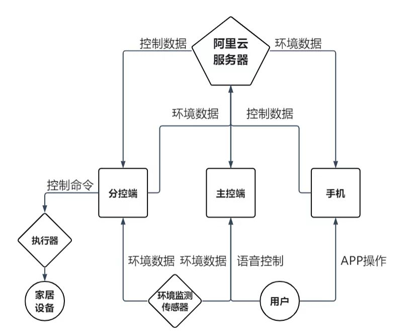

# 01 系统设计

## 1. 背景

智能家居的市场渗透率在逐年提高，但实际落地仍受几个问题限制：

1. **协议与生态割裂**：不同厂商的设备互不兼容，用户往往要买整套方案；
2. **安装门槛高**：不少方案需要在装修阶段预埋线路，后期加装要破坏墙面；
3. **目标用户错位**：现有产品多面向中大型住宅，而对智能家居兴趣更高的年轻人，居住条件往往是出租屋或小户型，既不能改线路，也不愿为整套系统付费。

本项目的出发点不是做一个功能最全的系统，而是回答一个问题：**在不能改线路、不能换面板的出租屋里，能不能用几百元的器件实现可用的灯光与环境控制？**

## 2. 目标用户与需求

目标用户是租住城中村或小户型的年轻人。由此推导出的需求优先级：

| 优先级 | 需求 | 约束 |
| --- | --- | --- |
| P0 | 开关灯 | 不能改市电线路，不能换开关面板 |
| P0 | 安装简单 | 不破坏墙面，搬家可拆走 |
| P1 | 多种控制方式 | 在家用语音，离家用手机 |
| P1 | 环境监测 | 温湿度、可燃气体 |
| P2 | 自动控制 | 按时间与光照自动关灯 |
| P2 | 成本低 | 主控 + 单分控控制在可接受范围 |

## 3. 技术选型

### 3.1 通信方式：WiFi

家庭 WiFi 普及率高，不需要额外网关；Zigbee 需要网关，蓝牙距离受限，有线方案需要施工。因此主控端与分控端都通过 WiFi 接入，使用 MQTT 与云端通信。

### 3.2 云平台：阿里云 IoT

选择阿里云主要因为：

- 物联网平台提供完整的设备接入、物模型、规则引擎；
- 支持自定义物模型与数据流转规则；
- 提供 HTTP API，便于 APP 或后台扩展。

设备侧使用 MQTT，适合数据量小、长连接的场景。

### 3.3 语音识别：本地离线模块

| 方案 | 成本 | 识别效果 | 依赖 |
| --- | --- | --- | --- |
| 联网语音识别 | 模块单价 100 元以上 | 词库大，但普通联网模块效果一般 | 必须联网 |
| 本地语音模块（HLK-V20） | 低 | 关键词可自定义，实测准确率较高 | 离线可用 |

本项目只需要“开灯 / 关灯 / 开空调 / 关空调”等固定指令，本地关键词识别足够，且不依赖网络。

### 3.4 开关控制：舵机拨动 vs 继电器改造

| 方案 | 是否改线路 | 安装 | 适用场景 |
| --- | --- | --- | --- |
| 继电器串入电路 | 是，需断开原有线路 | 需电工操作 | 自住房、装修阶段 |
| 舵机拨动翘板开关 | 否 | 插电即用，胶粘/支架固定 | 出租屋、已装修房 |

项目选择舵机方案：分控端固定在开关旁，舵机带动拨片按压开关，完全不接触 220V 线路。

### 3.5 主控架构：STM32 + ESP8266

主控端需要同时处理语音串口、I2C 温湿度、ADC 气体检测和红外发射，用 STM32 承担外设与实时逻辑；ESP8266 只作为联网模块，通过 AT 指令收发 MQTT。

分控端功能单一（ADC 采光、PWM 驱动舵机、MQTT 收发），直接用 ESP8266 兼作主控与联网，省掉一颗 MCU，降低成本与体积。

## 4. 系统架构



系统分为四个部分：

- **主控端**：STM32C8T6 + HLK-V20 + DHT20 + MQ-4 + ESP8266 + 红外发射；
- **分控端**：ESP8266 + 光敏电阻 + SG90 + USB 取电；
- **云平台**：阿里云 IoT，负责设备接入、消息转发、规则引擎；
- **手机 APP**：Android，订阅数据、下发控制命令。

### 4.1 数据流

**语音控制链路**

```
用户语音
  → HLK-V20 识别关键词
  → 串口 2 输出结果
  → STM32 解析
  → 串口 1 发送 AT 指令
  → ESP8266 发布 MQTT 消息
  → 阿里云规则引擎转发
  → 分控端 / APP 收到广播
```

**环境采集链路**

```
DHT20 / MQ-4 / 光敏电阻
  → STM32 或 ESP8266 采集
  → MQTT 上报
  → 阿里云
  → APP 显示（超阈值标红）
```

**远程控制链路**

```
APP 按钮
  → MQTT 发布
  → 阿里云规则转发
  → 分控端
  → 舵机拨动开关
```

### 4.2 为什么用广播而不是点对点

如果主控端直接把命令发给某个分控端，就需要维护设备地址表，新增分控时还要改主控固件。改用阿里云规则引擎把消息转发到所有相关 topic 后：

- 设备之间解耦，只认 topic；
- 新增分控端只需在云端加一条转发规则；
- APP 与分控端可以同时收到同一条命令，状态更容易保持一致。

代价是消息会发给所有订阅者，但本项目设备数量少，带宽可以忽略。

## 5. 设计约束

| 约束 | 影响 |
| --- | --- |
| 不接触市电 | 只能用舵机拨开关，无法读取灯具真实电流 |
| 单分控单开关 | 连排开关需要多个分控，成本上升 |
| 主控用核心板 | 体积偏大，外观难以做小 |
| 传感器为低成本型号 | 精度有限，阈值需要现场调整 |
| 依赖家庭 WiFi | 断网时远程控制与语音联动不可用；自动关灯仍在分控本地执行 |

## 6. 本章小结

本章从目标用户出发，确定了“免改造、低成本、三种控制方式”的设计目标，并对通信、云平台、语音识别、开关控制、主控架构做了选型。系统采用主控端 + 分控端 + 阿里云 + APP 的四层结构，通过云端广播实现设备解耦。
