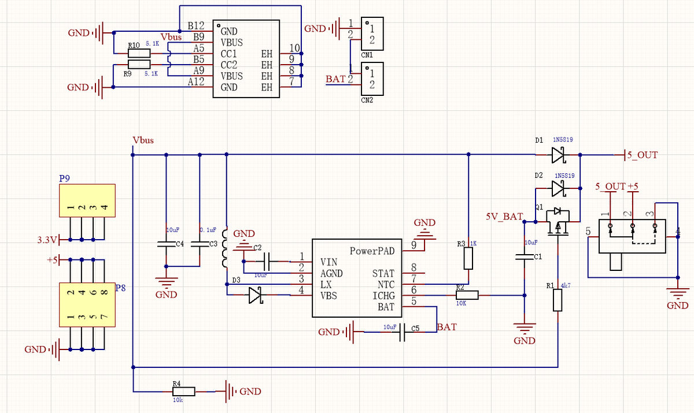
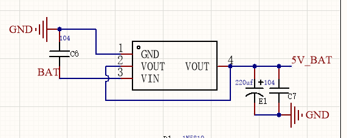
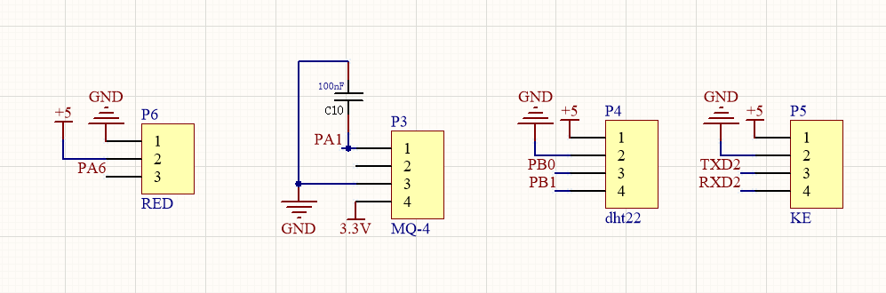
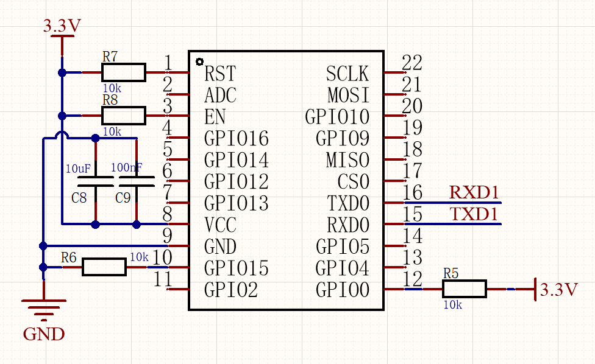
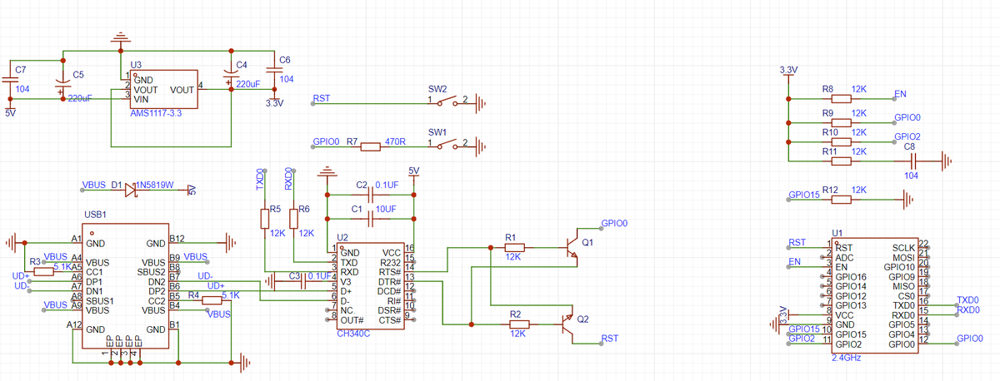
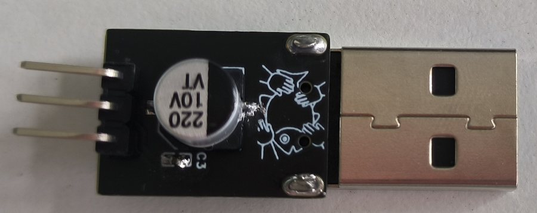
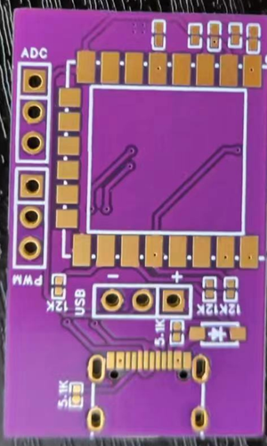
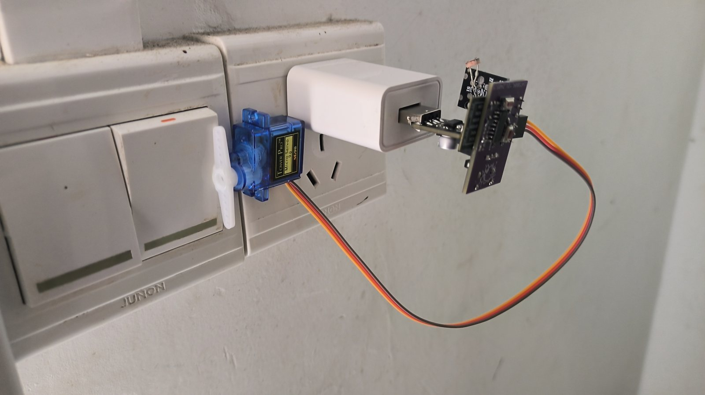
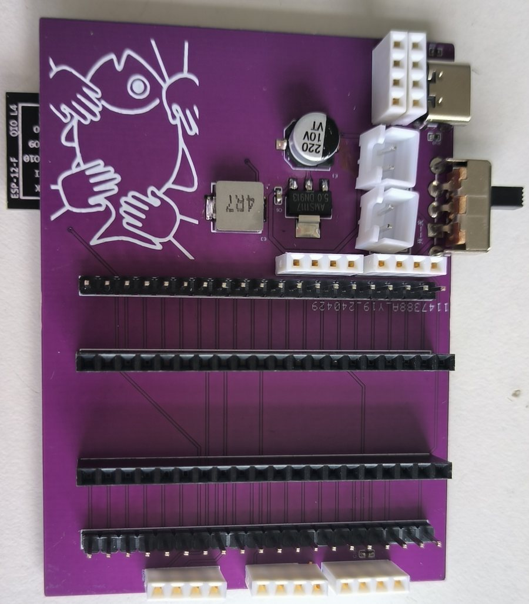

# 02 硬件设计

## 1. 硬件框图

### 主控端

```
        ┌──────────────┐
        │  HLK-V20     │ 语音识别
        │  语音模块     │
        └──────┬───────┘
               │ UART2
┌──────────────┴──────────────┐
│         STM32C8T6           │
│  · AHT20      (I2C)         │
│  · MQ-4       (ADC)         │
│  · 红外发射   (GPIO/PWM)     │
└──────────────┬──────────────┘
               │ UART1 (AT 指令)
        ┌──────┴───────┐
        │   ESP8266    │──── WiFi ──── 阿里云
        └──────────────┘
```

### 分控端

```
USB 5V ──→ AMS1117-3.3 ──┬──→ ESP8266
                          └──→ SG90 舵机
        ┌──────────────┐
        │   ESP8266    │
        │  · 光敏电阻 (ADC)
        │  · PWM 输出
        └──────┬───────┘
               │ PWM
        ┌──────┴───────┐
        │   SG90 舵机   │──→ 拨动墙面开关
        └──────────────┘
```

## 2. 主控端

### 2.1 器件

| 器件 | 接口 | 作用 |
| --- | --- | --- |
| STM32C8T6 核心板 | — | 主控，解析语音、采集环境、控制红外 |
| HLK-V20 | UART2 | 本地语音关键词识别 |
| AHT20 | I2C | 温湿度采集 |
| MQ-4 | ADC | 可燃气体浓度 |
| ESP8266 | UART1 | AT 指令联网，MQTT 收发 |
| 红外发射模块 | GPIO | 控制空调 |
| AMS1117-5V | — | 电池/USB 降压至 5V |

### 2.2 电源设计

主控端支持双路供电：

- **电池供电**：两节 3.7V 锂电池串联（约 7.4V），经 AMS1117-5V 降压后输入核心板；
- **USB 供电**：接入 Type-C 5V 时优先使用外部电源，同时通过电源管理芯片给电池充电；
- **3.3V**：由核心板上的稳压芯片从 5V 生成，供传感器与语音模块使用。



AMS1117 是线性稳压，7.4V 降到 5V 的压差较大，效率不高，但电路简单、成本低，适合本项目的小电流负载。电池充放电部分使用电源管理芯片，配合 Type-C 接口的 CC1/CC2 检测与两颗 5.1k 电阻，兼容 C-to-C 线缆。



### 2.3 外设接口

主控板把传感器与模块接口集中到排针和端子上，方便更换与调试。接口只对少量信号做了稳压处理，其余直接引出。



### 2.4 ESP8266 电路

主控端的 ESP8266 只作为 WiFi 模块使用，电路只需要三部分：

1. 3.3V 供电；
2. 拉高 EN（使能）引脚；
3. UART 与 STM32 的串口 1 交叉连接。



### 2.5 烧录电路

ESP8266 通过串口烧录，使用 CH340C 做 USB 转 TTL。烧录时需要把 RST 和 GPIO0 拉低，电路中用两个按键完成，避免每次手动短接。



## 3. 分控端

### 3.1 器件

| 器件 | 接口 | 作用 |
| --- | --- | --- |
| ESP8266 | — | 主控 + 联网 |
| 光敏电阻模块 | ADC | 环境亮度 |
| SG90 舵机 | PWM | 拨动开关 |
| AMS1117-3.3 | — | 5V 降 3.3V，两路输出 |
| USB 公头 | — | 直接插 5V 充电头取电 |

### 3.2 取电方式

分控端不内置电池，而是把 USB 公头直接插在墙面插座的 5V 充电头上。为了让模块更贴合墙面，设计了一块 USB 转接板，把常见的卧式 USB 公头转成立式，减小整体厚度。



5V 经 AMS1117-3.3 降压后分两路输出，分别供 ESP8266 与舵机。舵机在 3.3V 下扭矩有限，但拨动轻触式翘板开关足够；如果换用更硬的开关，需要把舵机改接 5V。

### 3.3 PCB

分控板把 ESP8266 模块、光敏电阻接口、舵机接口和电源电路集成在一块小板上，整体尺寸约 3 × 4 × 2 cm。



## 4. 结构设计

### 4.1 舵机与开关的配合

最初直接用玻璃胶把舵机粘在开关面板上，靠舵机臂压动开关。长期使用后发现两个问题：

- 胶体老化后舵机位移，按压位置偏移；
- 舵机臂与开关表面摩擦力不足，偶尔打滑。

改进方案是在舵机前端加装一个专用拨片结构，把旋转运动转化为对开关的推压，减小所需力度，同时用支架限制舵机位置。改进后测试期间未再出现按压失败。



### 4.2 外壳与固定

主控端的外壳按模块尺寸做了镂空与加固：传感器开孔保证空气流通，语音模块开孔保证拾音，电池仓单独固定。分控端体积小，直接用 USB 插头支撑，背面加防滑垫。

### 4.3 体积问题

主控端使用 STM32C8T6 核心板，核心板本身占用了较大面积，导致整机体积偏大，外观难以进一步缩小。这是本设计在结构上的主要遗留问题。

## 5. PCB 实物

| 主控端 | 分控端 |
| --- | --- |
|  |  |

主控板集成锂电池充放电、5V 降压、ESP8266 固定、传感器接口；分控板集成 3.3V 稳压、ESP8266、光敏与舵机接口。

## 6. 本章小结

硬件部分完成了主控端与分控端的电路、PCB 和结构设计：

- 主控端支持电池与 USB 双路供电，自带充电管理；
- 分控端通过 USB 取电，体积小、即插即用；
- 开关控制采用舵机拨片，不接触市电；
- 烧录电路用按键切换 RST/GPIO0，方便反复烧写。

遗留问题是主控端体积偏大，以及舵机方案对开关的适配性依赖结构件精度。
