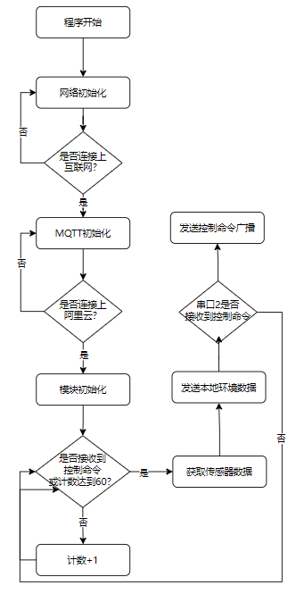
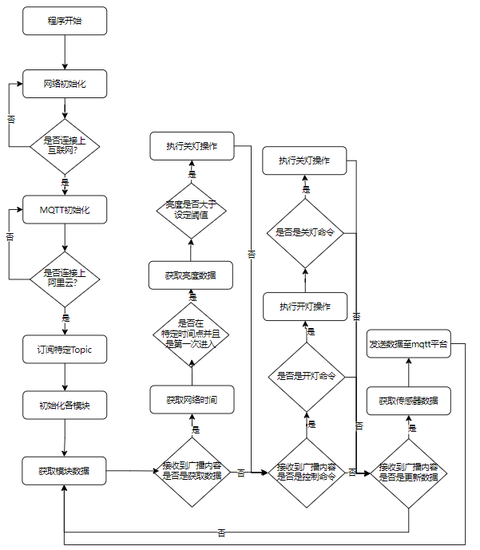

# 03 固件设计

> 固件源码位于本仓库 [`firmware/`](../firmware/)：
> - 主控端：`firmware/stm32/control_bedroom`、`control_parlor`
> - 分控端：`firmware/esp8266/switch_bedroom`、`switch_parlor`
>
> 源码中的 WiFi、ProductKey、MQTT 密码已替换为占位符，编译前需要改成自己的配置。

## 1. 主控端固件

主控端基于 STM32C8T6，裸机运行，使用串口中断处理语音命令，没有引入 RTOS。

### 1.1 启动流程



`main()` 的初始化顺序：

1. `Init_I2C_Sensor_Port()`：初始化 AHT20 的 I2C 引脚；
2. `Adc_Init()`：MQ-4 所在 ADC 通道；
3. `delay_init()`、中断优先级分组、`uart_init(115200)`；
4. `uart2_init(115200)`：与语音模块通信；
5. `esp_init()`：通过 AT 指令配置 ESP8266 并连接阿里云；
6. AHT20 状态检查：读状态字，若不是 `0x18` 则重新初始化寄存器。

`esp_init()` 的 AT 指令序列：

```
AT+CIPSNTPCFG=1,8,"ntp1.aliyun.com"       // 时区与 SNTP
AT+MQTTUSERCFG=0,1,"NULL","<clientId>","<username>","<password>",0,0,""
AT+MQTTCLIENTID=0,"22|securemode=3,signmethod=hmacsha1,timestamp=11|"
AT+MQTTCONN=0,"<ProductKey>.iot-as-mqtt.cn-shanghai.aliyuncs.com",1883,1
AT+MQTTSUB=0,"/<ProductKey>/control_bedroom/user/change",1
AT+MQTTPUB=0,"/<ProductKey>/control_bedroom/user/change","{\"data\":\"get\"}",0,0
```

最后一条 `get` 是上电后主动请求一次数据，经规则引擎转发后触发分控上报灯状态，APP 不必等待 5 分钟的定时周期。

每条指令之间用 `delay_ms(50000)` 或 `delay_ms(60000)` 等待模块响应，因此主控从上电到可用的时间较长。源码中 WiFi 连接指令（`AT+CWJAP`）被注释，说明当时 ESP8266 模块已经保存了 WiFi 配置，上电后自动重连。

### 1.2 主循环与定时上报

主循环以 5 秒为周期计数，累计 60 次后采集并上报一次环境数据：

```c
while (1) {
    Delay_1ms(5000);
    data_send += 1;
    if (data_send > 60) {
        adcx = Get_Adc_Average(ADC_Channel_1, 10);
        AHT20_Read_CTdata(CT_data);
        // ...换算温湿度...
        printf("AT+MQTTPUB=0,\"...\",\"{\\\"bedroom_temp\\\":\\\"%.1f\\\"}\",0,0\r\n", t);
        delay_ms(30000);
        printf("AT+MQTTPUB=0,\"...\",\"{\\\"bedroom_hum\\\":\\\"%.1f\\\"}\",0,0\r\n", c);
        delay_ms(30000);
        printf("AT+MQTTPUB=0,\"...\",\"{\\\"bedroom_gas\\\":\\\"%d\\\"}\",0,0\r\n", adcx);
        delay_ms(30000);
        data_send = 0;
    }
    // data_get == 1 时执行同样的上报流程
}
```

按参数计算，定时上报的周期是 5 秒 × 60 = 5 分钟；三条数据之间各间隔 30 秒，避免 AT 指令发送过快。

另外，串口 1 收到 `get` 时会置位 `data_get`，主循环检测到后立即上报一次，并清零计数。

### 1.3 语音命令解析

语音模块 HLK-V20 接在串口 2。模块配置为每个关键词输出一个字节，STM32 在 `USART2_IRQHandler` 中按字节值映射命令：

| 接收字节 | 含义 | 发布的消息 |
| --- | --- | --- |
| `0x20`（32） | 开卧室灯 | `{"data":"room_light_on"}` |
| `0x10`（16） | 关卧室灯 | `{"data":"room_light_off"}` |
| `0x30`（48） | 开客厅灯 | `{"data":"parlor_light_on"}` |
| `0x40`（64） | 关客厅灯 | `{"data":"parlor_light_off"}` |

收到字节后直接 `printf` 一条 `AT+MQTTPUB`，由 ESP8266 发到云端。语音关键词与输出字节的对应关系在模块配置网页中设置。

### 1.4 环境采集

**AHT20（I2C）**

AHT20 是 I2C 接口的温湿度传感器。上电后先读状态字，判断是否需要初始化；测量时发送触发命令，读取 2 个 32 位数据，再换算：

```c
c1 = CT_data[0] * 100 * 10 / 1024 / 1024;          // 湿度，放大 10 倍
t1 = CT_data[1] * 200 * 10 / 1024 / 1024 - 500;    // 温度，放大 10 倍
```

> 毕业设计正文中写作 DHT20，源码与实物模块为 AHT20，本文以源码为准。两者都是 I2C 温湿度传感器，寄存器和换算方式不同。

**MQ-4（ADC）**

MQ-4 输出模拟电压，代码用 `Get_Adc_Average(ADC_Channel_1, 10)` 取 10 次平均，直接上报 ADC 原始值，没有做浓度标定。

**光敏电阻（分控端）**

分控端用 `system_adc_read()` 读取光敏电阻分压，作为亮度判断依据。

### 1.5 红外空调控制

主控端预留了红外发射模块的驱动（`HARDWARE/REMOTE`），语音命令表中没有把空调指令接入 MQTT。红外码的发送逻辑在 `remote.c` 中。

## 2. 分控端固件

分控端以 ESP8266 为主控，基于 ESP8266 NONOS SDK 开发，负责采集亮度、驱动舵机、收发 MQTT。

### 2.1 启动流程



`user_init()` 的初始化顺序：

1. 串口 115200；
2. GPIO14 设为输出，作为舵机信号脚；
3. `pwm_init(43000, duty, 1, io_info)`，初始占空比 33333（舵机中位）；
4. 初始化状态 LED；
5. 配置 WiFi 并连接；
6. 获取 IP 后启动 SNTP 对时。

SNTP 成功拿到时间后，关闭对时定时器并调用 `MQTT_Connect()`。也就是说，**分控端先对时、再连 MQTT**，以保证自动关灯的时间判断可用。

### 2.2 舵机 PWM

PWM 周期设为 43000，初始占空比 33333 对应舵机中位。开灯和关灯通过改变占空比实现，动作 150 ms 后回到中位：

```c
void light_on(void) {
    pwm_set_duty(34000, 0);
    pwm_start();
    os_delay_us(150000);
    pwm_set_duty(42000, 0);   // 回中
    pwm_start();
}

void light_off(void) {
    pwm_set_duty(50000, 0);
    pwm_start();
    os_delay_us(150000);
    pwm_set_duty(42000, 0);   // 回中
    pwm_start();
}
```

舵机不是持续通电按住开关，而是“转过去—停 150 ms—回中”，避免堵转发热。

### 2.3 MQTT 消息处理

连接成功后，分控端订阅自己的 topic，并发布一条上线消息：

```c
MQTT_Subscribe(client, "/<ProductKey>/switch_bedroom/user/change", 0);
MQTT_Publish(client, "...", "ESP8266_Online", ...);
```

`mqttDataCb` 把收到的 payload 当作字符串，与预设 JSON 逐条比对：

| 收到的消息 | 动作 |
| --- | --- |
| `{"data":"room_light_on"}` | 开灯 |
| `{"data":"room_light_off"}` | 关灯 |
| `{"data":"bedroom_light_check"}` | 把当前 ADC 值设为亮度阈值 |
| `{"data":"get"}` | 读取亮度与时间，上报灯的状态 |
| `{"data":"10"}` / `{"data":"22"}` | 手动设置时间点 |

收到 `get` 时，根据亮度与阈值的关系上报状态：

```c
if (light_adc > light_check)
    MQTT_Publish(..., "{\"light_bedroom\":\"off\"}", ...);
else
    MQTT_Publish(..., "{\"light_bedroom\":\"on\"}", ...);
```

### 2.4 自动关灯

分控端用两个状态变量记录昼夜：

- 时间到达 **22 点**且 `day == 1` → `night = 1, day = 0`；
- 时间到达 **10 点**且 `night == 1` → `day = 1, night = 0`，并判断亮度：

```c
if (os_strcmp(time, "10") == 0 && night == 1) {
    day = 1;
    night = 0;
    if (light_adc < light_check)
        light_off();
}
```

即：**早上 10 点，如果记录到的亮度低于阈值，就执行一次关灯**。

这里有两个实现上的限制，阅读源码时需要注意：

1. `light_adc` 只在收到 `get` 命令时更新，自动关灯用的是最近一次查询时的亮度，不是当前实时值；
2. 时间比较和自动关灯都写在 `mqttDataCb` 里，只有收到 MQTT 消息时才会执行，不是独立定时任务。

这两点在 [06 复盘](06-retrospective.md) 中有进一步分析。

## 3. 通信协议

### 3.1 物模型

阿里云产品 `smart_home` 定义了 9 个属性：

| 功能名称 | 标识符 | 类型 | 取值范围 | 实际上报 |
| --- | --- | --- | --- | --- |
| 控制命令 | `control` | int32 | 0–100 | 未使用 |
| 卧室温度 | `temp_bedroom` | float | -50–50 | `bedroom_temp` |
| 卧室湿度 | `hum_bedroom` | float | 0–100 | `bedroom_hum` |
| 卧室可燃气体 | `bedroom` | float | 0–100 | `bedroom_gas`（ADC 原始值） |
| 卧室亮度 | `light_bedroom` | float | 0–100 | `on` / `off` |
| 客厅温度 | `temp_parlor` | float | -50–50 | `parlor_temp` |
| 客厅湿度 | `hum_parlor` | float | 0–100 | `parlor_hum` |
| 客厅可燃气体 | `parlor` | float | 0–100 | `parlor_gas` |
| 客厅亮度 | `light_parlor` | float | 0–100 | `on` / `off` |

源码里的 JSON 字段名与物模型标识符并不完全一致（如 `bedroom_temp` vs `temp_bedroom`），云端规则只做转发、不做字段校验，所以能跑通；如果要用物模型解析，需要统一命名。

### 3.2 Topic

```
/{ProductKey}/{DeviceName}/user/change
```

规则引擎把消息转发到 5 个 topic：

| 目标 | Topic |
| --- | --- |
| 卧室分控 | `/<ProductKey>/switch_bedroom/user/change` |
| 客厅分控 | `/<ProductKey>/switch_parlor/user/change` |
| 卧室主控 | `/<ProductKey>/control_bedroom/user/change` |
| 客厅主控 | `/<ProductKey>/control_parlor/user/change` |
| 手机 APP | `/<ProductKey>/APP_control/user/change` |

### 3.3 消息格式

| 方向 | 消息示例 | 说明 |
| --- | --- | --- |
| 主控 → 云 | `{"bedroom_temp":"27.5"}` | 温度，字符串形式的浮点数 |
| 主控 → 云 | `{"bedroom_hum":"76.4"}` | 湿度 |
| 主控 → 云 | `{"bedroom_gas":"27"}` | MQ-4 的 ADC 原始值 |
| 主控 → 云 | `{"data":"room_light_on"}` | 语音开卧室灯 |
| 分控 → 云 | `{"light_bedroom":"off"}` | 灯状态上报 |
| 分控 → 云 | `ESP8266_Online` | 上线通知 |
| APP → 云 | `{"data":"get"}` | 请求上报 |
| APP → 云 | `{"data":"bedroom_light_check"}` | 把当前亮度记为阈值 |
| APP → 云 | `{"data":"10"}` / `{"data":"22"}` | 手动设置时间点 |

消息体没有统一的 schema，全靠字符串比对，这是当时为了快速实现做的取舍。

## 4. 配置说明

源码中所有环境相关配置都替换成了占位符：

| 占位符 | 位置 | 说明 |
| --- | --- | --- |
| `YOUR_WIFI_SSID` | `mqtt_config.h` | WiFi 名称 |
| `YOUR_WIFI_PASSWORD` | `mqtt_config.h` | WiFi 密码 |
| `YOUR_PRODUCT_KEY` | `mqtt_config.h`、`usart2.c`、`user_main.c` | 阿里云 ProductKey |
| `YOUR_MQTT_PASSWORD` | `mqtt_config.h`、`usart2.c` | 阿里云 MQTT 密码（HMAC 签名） |

主控端的 `AT+MQTTUSERCFG` 中，username 的格式是 `DeviceName&ProductKey`。

## 5. 本章小结

主控端以 STM32 处理语音、传感器与红外，ESP8266 只负责联网；分控端用 ESP8266 同时承担控制与通信。两端通过阿里云 MQTT 交换数据，规则引擎负责广播。

从源码看，这套固件是“能跑通”的版本，不是工程化版本：消息格式不统一、自动关灯依赖 MQTT 消息触发、配置硬编码。这些问题在复盘中有记录。
