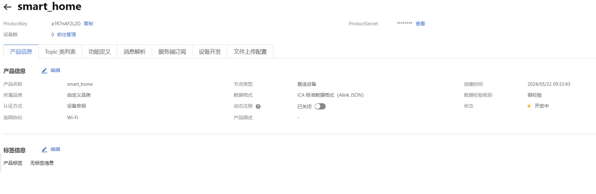
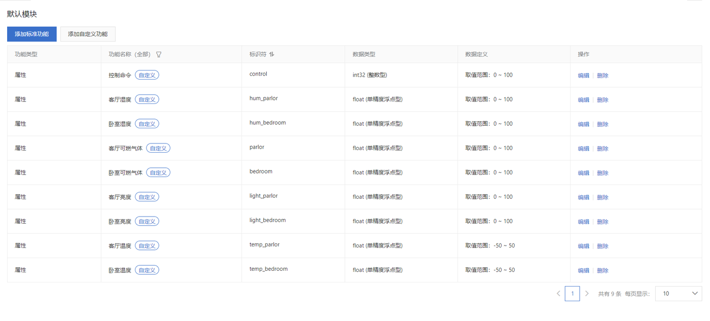
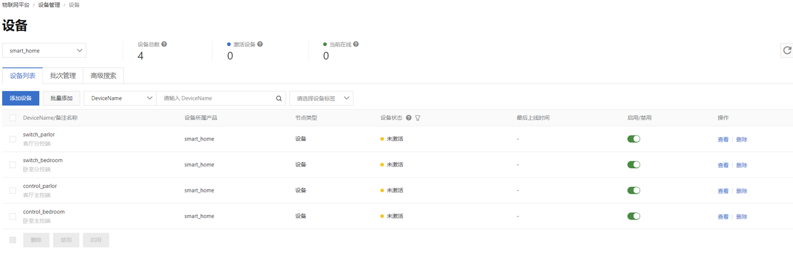
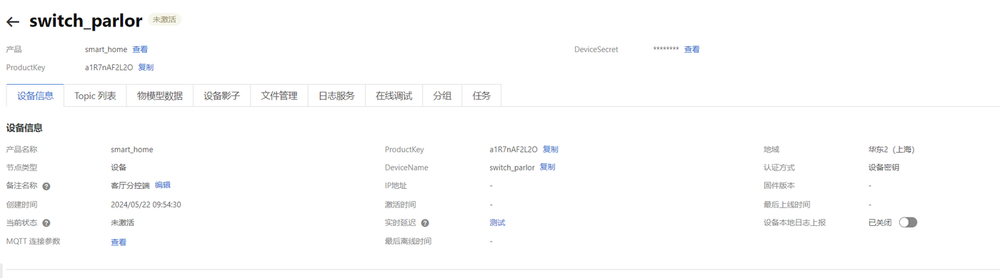
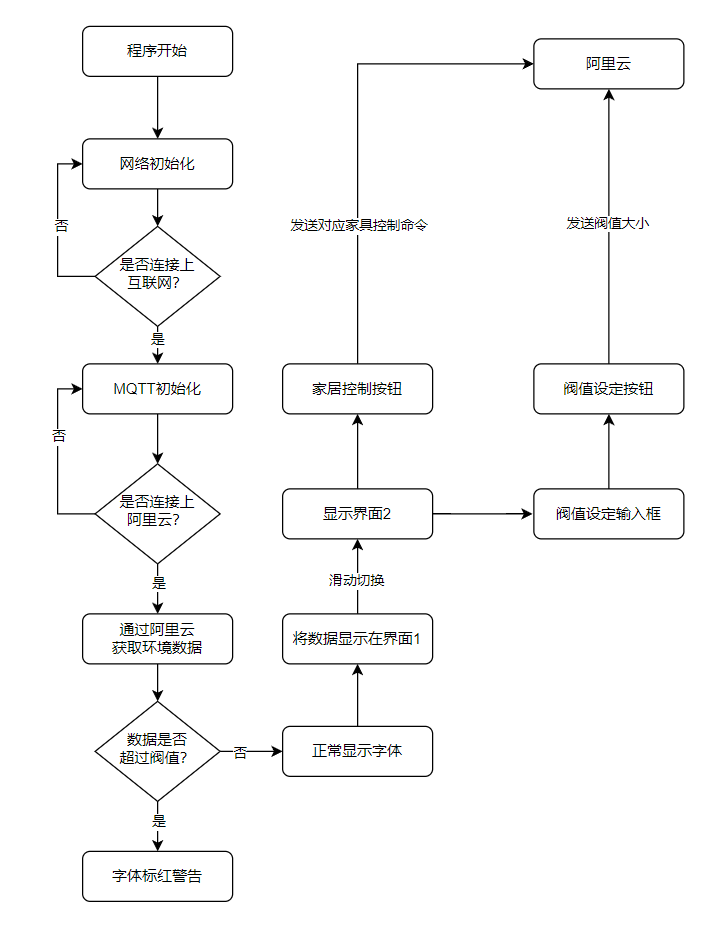

# 04 云平台与 Android APP

## 1. 阿里云 IoT 平台

系统使用阿里云物联网平台的公共实例，负责设备接入、物模型管理、消息转发和规则引擎。

### 1.1 创建产品

在物联网平台创建产品 `smart_home`，节点类型选择直连设备，联网方式为 WiFi，数据格式为 JSON。



### 1.2 定义物模型

产品下定义 9 个属性，覆盖卧室与客厅的温度、湿度、可燃气体浓度、亮度，以及一个整型控制命令。



| 功能名称 | 标识符 | 类型 | 范围 |
| --- | --- | --- | --- |
| 控制命令 | `control` | int32 | 0–100 |
| 卧室温度 | `temp_bedroom` | float | -50–50 |
| 卧室湿度 | `hum_bedroom` | float | 0–100 |
| 卧室可燃气体 | `bedroom` | float | 0–100 |
| 卧室亮度 | `light_bedroom` | float | 0–100 |
| 客厅温度 | `temp_parlor` | float | -50–50 |
| 客厅湿度 | `hum_parlor` | float | 0–100 |
| 客厅可燃气体 | `parlor` | float | 0–100 |
| 客厅亮度 | `light_parlor` | float | 0–100 |

### 1.3 创建设备

产品下创建 4 个设备：

| 设备 | 作用 |
| --- | --- |
| `control_bedroom` | 卧室主控端 |
| `control_parlor` | 客厅主控端 |
| `switch_bedroom` | 卧室开关分控 |
| `switch_parlor` | 客厅开关分控 |

每个设备有独立的 DeviceName 与 DeviceSecret，用于 MQTT 认证。APP 侧使用 MQTT 客户端接入，订阅规则转发出来的 `APP_control` topic。



### 1.4 设备接入

- **主控端**：STM32 通过串口向 ESP8266 发送 AT 指令，依次配置 WiFi、MQTT 参数，再连接阿里云；
- **分控端**：WiFi 与 MQTT 参数直接写在固件里，编译后烧录到 ESP8266；
- **APP**：使用 Android 的 MQTT 客户端库连接阿里云，订阅规则转发出来的 `APP_control` topic。

设备详情页可以看到物模型数据和运行状态：



### 1.5 规则引擎与消息广播

云端配置了一条数据流转规则，查询语句为：

```sql
SELECT * FROM "/<ProductKey>/+/user/change"
```

规则把任意设备发到 `user/change` 的消息，转发到 5 个目标 topic：


| 目标 | Topic |
| --- | --- |
| 卧室分控 | `/<ProductKey>/switch_bedroom/user/change` |
| 客厅分控 | `/<ProductKey>/switch_parlor/user/change` |
| 卧室主控 | `/<ProductKey>/control_bedroom/user/change` |
| 客厅主控 | `/<ProductKey>/control_parlor/user/change` |
| APP | `/<ProductKey>/APP_control/user/change` |

这种“全量转发”的方式牺牲了一点带宽，换来设备之间的完全解耦：新增分控端时，只需要在规则里加一条转发目标，不用改主控固件。

> 截图中的 ProductKey 与设备密钥已做打码处理，文中统一写作 `<ProductKey>`。复现时需要创建自己的产品与设备。

## 2. Android APP

APP 使用 Android Studio 开发，基于 Java，主要做三件事：显示环境数据、下发控制命令、设置亮度阈值。

### 2.1 界面设计

**数据查看界面**

显示卧室与客厅的温度、湿度、可燃气体浓度。顶部两个按钮：

- `刷新连接状态`：建立/检查 MQTT 连接，连接成功后按钮文字变绿；
- `刷新室内数据`：主动向主控端请求一次数据。

不点击刷新时，APP 每 10 分钟接收一次主控端定时上报的数据。数值超过阈值时，字体标红告警。


**灯具控制界面**

按房间分为卧室与客厅两组，每组有开灯、关灯、刷新亮度三个按钮，并显示当前灯的状态（“灯灭了”“灯未连接”等）。页面下方可以输入亮度阈值并下发到分控端。


### 2.2 程序流程



APP 启动后先初始化网络、连接 MQTT；连接成功后订阅数据 topic。收到数据后：

1. 与阈值比较，正常显示或标红；
2. 显示在界面 1；
3. 用户滑动切换到界面 2，可下发控制命令或设置阈值。

### 2.3 MQTT 客户端

APP 侧使用 MQTT 客户端库连接阿里云，需要配置：

- Broker 地址与端口；
- ProductKey、DeviceName、DeviceSecret；
- 订阅的 topic；
- 回调中解析 JSON，更新 UI。

控制命令发布到 APP 对应的 topic，由云端规则转发到分控与主控。

## 3. 云端与 APP 的配合

| 场景 | 消息路径 |
| --- | --- |
| 语音开灯 | 主控 → 云端 → 分控 + APP |
| APP 开灯 | APP → 云端 → 分控 + 主控 |
| 环境上报 | 主控 → 云端 → APP |
| 亮度上报 | 分控 → 云端 → APP（按需） |
| 阈值设置 | APP → 云端 → 分控 |

云端不保存历史数据，只做消息中转。如果需要历史曲线，可以在规则引擎中增加转发到表格存储或时序数据库的目标。

## 4. 本章小结

云平台部分完成了产品、物模型、设备、规则引擎的配置；APP 部分完成了数据展示、远程控制和阈值设置。整套系统的“云”只承担消息总线的作用：自动关灯的判断在分控本地执行，受网络影响较小；语音命令仍需经云端转发，断网时会失效。
